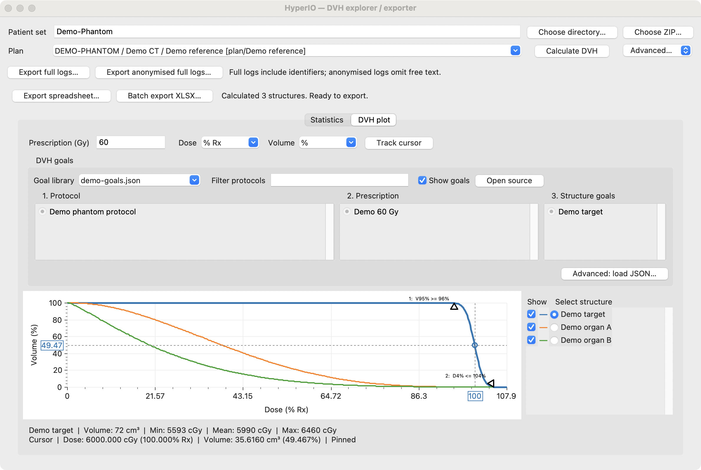
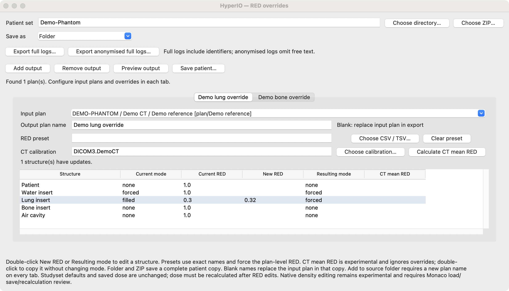
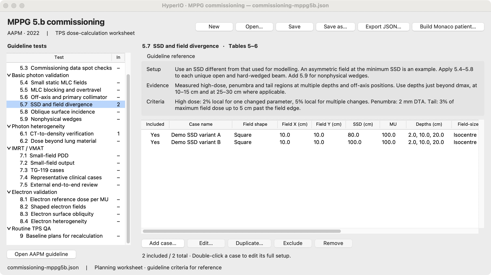

# HyperIO desktop applications

Use these Windows and macOS apps to review Monaco dose exports, prepare density override variants, and organise commissioning cases.
The screenshots show HyperIO running on macOS with synthetic examples and the bundled demo worksheet.

## Install and launch

Install the `applications` extra in a Python 3.10+ environment with Tk support. [Installation instructions](../README.md#install)

| Workflow | Installed launcher |
| --- | --- |
| [DVH spreadsheet exporter](#dvh-spreadsheet-exporter) | `hyperio-dvh-exporter` |
| [RED overrides](#red-overrides) | `hyperio-red-overrides` |
| [MPPG 5.b commissioning worksheet](#mppg-5b-commissioning-worksheet) | `hyperio-commissioning` |

Run the launcher from `.venv\Scripts\` on Windows or `.venv/bin/` on macOS.
For Nix and source checkout launchers, see the [desktop reference](../docs/desktop-applications.md#run-from-the-checkout).

## DVH spreadsheet exporter

Reconstruct DVHs from saved Monaco dose and contours, inspect curves and statistics, and export XLSX or CSV.

1. Choose a Monaco patient folder or ZIP and select a plan with saved dose.
2. Select **Calculate DVH**.
   Review the **Statistics** and **DVH plot** tabs.
3. Select a structure to inspect its curve and click the plot to pin a dose and volume readout.
   Enter **Prescription (Gy)** to display dose as a percentage of prescription and plot relative-dose goals.
4. Select **Export spreadsheet…** for the current plan or **Batch export XLSX…** to select multiple plans.

Use **Goal library** to overlay eviQ, TCC, or locally supplied goals and **Open source** to review the selected protocol and prescription.
Goal markers support visual review.
Reconstructed statistics depend on the contour and histogram conventions, so compare them with Monaco for your intended use.
Review warnings and the exported provenance, especially when a contour was repaired or a structure was unavailable. [DVH reference and validation links](../docs/desktop-applications.md#dvh-exports-and-diagnostics)

## RED overrides

Prepare plan copies with modified structure relative electron density (RED) settings.

1. Choose a Monaco patient folder or ZIP, then select an **Input plan**.
2. Double-click **New RED** or **Resulting mode** to edit a structure.
   To apply a preset, load a CSV or TSV with `structure` and `red` columns and exact structure names.
3. For CT-derived values, choose the applicable Monaco calibration and select **Calculate CT mean RED**.
   Double-click a result to copy it into **New RED**, then check the resulting mode.
4. Use **Add output** for another variant and enter a name for each new plan copy.
   Choose **Folder**, **ZIP**, or **Add to source folder**, then select **Save patient…**.

Folder and ZIP save a full patient copy.
A blank name replaces the input plan within that copy.
**Add to source folder** requires a directory input and a new name for each plan copy.
CT mean RED describes the CT-derived density before overrides.
Open experimental plan copies in Monaco, verify the density settings, and recalculate dose before comparing variants. [RED calibration and export reference](../docs/desktop-applications.md#red-calibration-and-export)

## MPPG 5.b commissioning worksheet

*This feature is not yet complete.*

Organise local dose calculation commissioning cases by guideline test and stage phantom plans from Monaco templates.

1. Open the [demo worksheet](../examples/commissioning-mppg5b.json) or select **New**.
2. Select a guideline test and use **Add case…** or **Duplicate…** to record your local setup.
3. Use **Save** to keep the whole worksheet or **Export JSON…** to export included cases.
4. Use **Build Monaco patient…** to assign saved phantom templates and stage a patient folder under a new ID.
   Open the staged plans in Monaco and check the studyset, beams, MU and calculation settings before calculating.

Choose a template whose machine, geometry, aperture and MU already match the intended setup.
The builder inherits beam and prescription records from the template.
The demo cases contain fictional setups. [Plan setup guide](../docs/mppg5b-plan-set.md) · [Plan staging reference](../docs/desktop-applications.md#commissioning-plan-staging)
